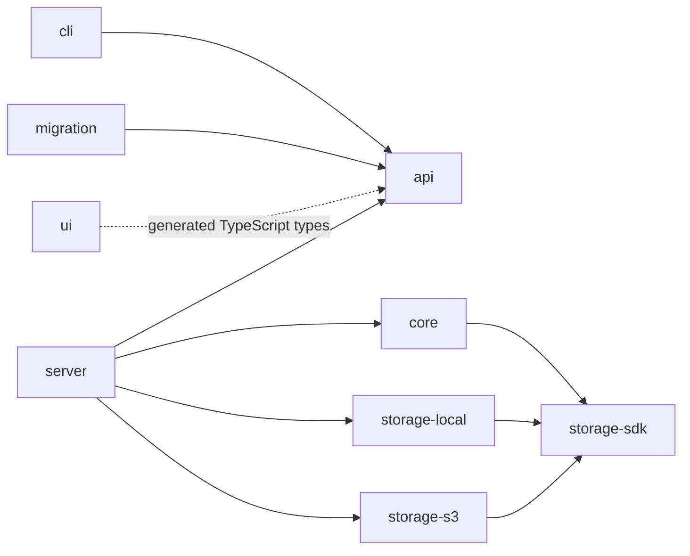
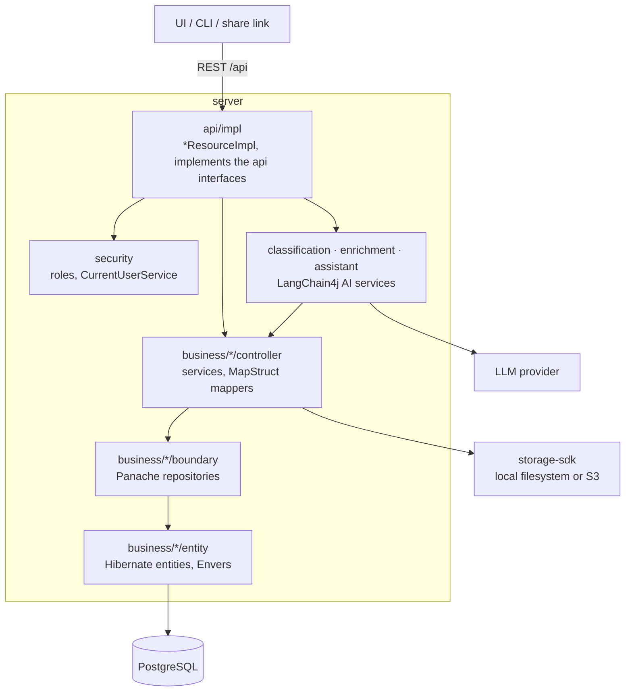

# Building Blocks

SAM is a multi-module Maven project (`de.halbmann:sam`). Each module has a clear responsibility:

```
sam (parent)
 +-- api            Contracts: JAX-RS interfaces, DTOs, enums
 +-- core           Shared business logic (exceptions, utilities)
 +-- storage        Storage abstraction
 |    +-- storage-sdk     SPI (FileSystemProvider, FileSystemWrapper)
 |    +-- storage-local   Local filesystem implementation
 |    +-- storage-s3      AWS S3 implementation
 +-- server         Quarkus runtime: REST impls, JPA entities, services
 +-- ui             Angular frontend (served via Quarkus Quinoa)
 +-- cli            PicoCLI batch import/export tool (REST client)
 +-- migration      Legacy-data conversion for the cli import tool
```

## Module Dependencies



- **api** defines the contract. No runtime dependencies.
- **server** implements everything. Only module with JPA, Hibernate, Flyway, LangChain4j.
- **cli** consumes the same `api` interfaces as a MicroProfile REST Client.
- **migration** depends only on `api` (for the DTOs it converts legacy data into) — its output is consumed by `cli`, not the other way around.
- **ui** receives auto-generated TypeScript types from `api` DTOs via `typescript-generator-maven-plugin`.
- **core** holds framework-free helpers (fingerprinting, hashing, text normalisation, exceptions); its `storage-sdk` dependency is declared in the POM but not used in code yet.

## Inside the Server

The `server` module is layered per domain area: `business/<area>/` (sheets, collections,
documents, ensembles, instruments, members, persons, shares, eventlog, myparts) has `boundary/`
for Panache repositories, `controller/` for services and MapStruct mappers, and `entity/`
for the Hibernate entities. The REST layer and the cross-cutting packages sit around it:



## Related

- [API Design](concepts/api-design.md) — how the shared-interface contract works
- [Storage & Deduplication](concepts/storage-and-deduplication.md) — the storage SPI
- [Technology Stack](tech-stack.md)
