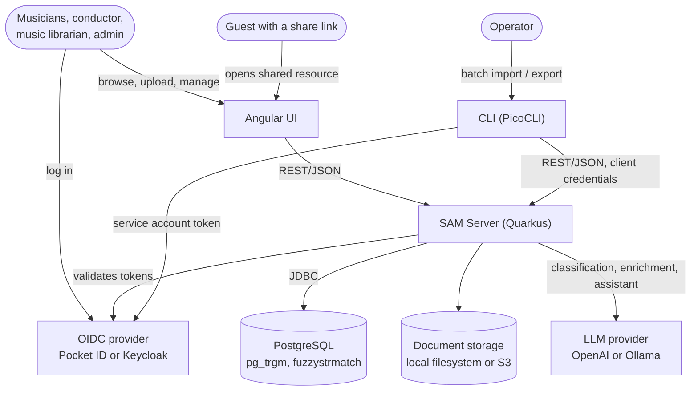

# Context & Scope

SAM is a web application for archiving sheet music, managing instrumentations, musicians, and collections for bands and ensembles. It helps answer questions like: *"Do we have all the parts we need to play this piece with our brass ensemble?"*

For the human-centred view (personas, use cases, flows) see [Stakeholders](../stakeholders.md).

## System Context

**Users** work in the Angular frontend; the CLI handles batch imports and exports. The server is the single backend: it checks the tokens issued by the OIDC provider, persists to PostgreSQL, and stores documents via a pluggable storage layer. AI features use LangChain4j with a configurable LLM provider.

## Key Quality Goals

| Priority | Goal | Approach |
|----------|------|----------|
| 1 | Findability | Full-text search with fuzzy matching, phonetic search, trigram similarity |
| 2 | Traceability | Full audit trail via Hibernate Envers on all entities |
| 3 | Extensibility | API-first design, pluggable storage, shared interfaces across clients |

A stakeholder-derived, more detailed version of these goals lives in [Stakeholders §2](../stakeholders.md#2-quality-goals).

## Related

- [Building Blocks](building-blocks.md) — module structure
- [Deployment](deployment.md) — how the system is shipped and run
