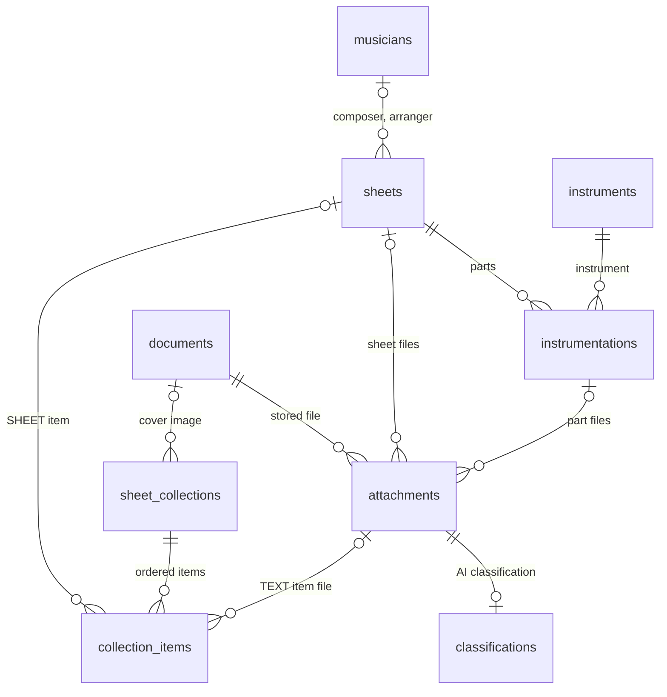
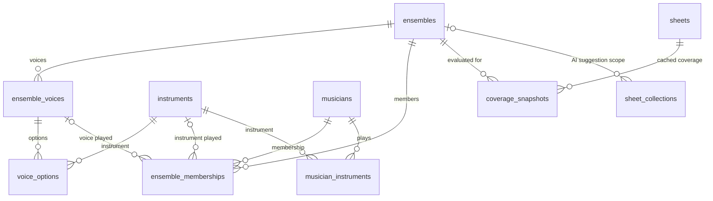

# Data Model

The diagrams show tables and their foreign keys as created by the Flyway migrations; the
columns are listed in [Entity Details](#entity-details). Join tables (`sheets_attachments`,
`instrumentations_attachments`, `sheet_collections_items`) are drawn as the relationship
they implement, and `_AUD` tables are left out.

## Core Entities

Collections are `FOLDER`s or `SETLIST`s; their items are `SHEET` or `TEXT` rows.

## Ensemble & Coverage Entities

Voice options are `PRIMARY`, `ALTERNATE`, or `FALLBACK`. `shares` and `event_log` have no
foreign keys: they reference their resource by type and ID, so they also cover deleted
entities.

## Entity Details

| Entity | PK | Key Fields |
|--------|----|------------|
| `sheets` | UUID | title, subtitle, composer, arranger, genre, fingerprint, **source**, **rightsStatus**, **gemaReportable**, **tempo**, **tonality**, **arrangementPublisher**, **arrangementRightsUntil** |
| `instrumentations` | UUID | sheet (FK), instrument (FK), partLabel, clef, notationType, **pages**, physicalLocation, physicalCondition |
| `instruments` | String | name, displayName, transposition, **family**, **defaultClef**, **catalogSection**, **catalogPosition** |
| `instrument_aliases` | (instrument_id, alias_order) | alias strings for OCR matching; ordered list per instrument |
| `musicians` | UUID | name, birthYear, deathYear, ipi, **userId** (OIDC subject — null for external/historical musicians), **email**, **mobile**, **notes**, **status**, **role**, **lastInviteSentAt** |
| `musician_instruments` | UUID | musician (FK), instrument (FK), isPrimary — instrument assignments driving "My Parts" personalisation |
| `documents` | UUID | filename, path, sha256, mimeType, size, refCount |
| `attachments` | UUID | document (FK), type, displayName |
| `sheet_collections` | UUID | name, description, type (FOLDER/SETLIST), date, **visibility**, **coverColor**, **coverImageId** (FK → documents), **ensembleId** (FK → ensembles, nullable, ON DELETE SET NULL — scopes coverage-aware AI suggestions) |
| `collection_items` | UUID | item_type discriminator (SHEET/TEXT, single-table inheritance): SHEET rows carry sheet (FK), TEXT rows carry identifier, textContent, attachment (FK, nullable); ordered per collection via `sheet_collections_items` join table |
| `ensembles` | UUID | name, description |
| `ensemble_voices` | UUID | ensemble (FK), label, weight, required |
| `voice_options` | UUID | voice (FK), instrument (FK), type, factor |
| `ensemble_memberships` | UUID | musician (FK), ensemble (FK), voice (FK, nullable), instrument (FK, nullable), conductor (bool) — one row per musician per voice per ensemble |
| `shares` | UUID | creatorUserId, resourceType, resourceId, expiresAt, revokedAt, createdAt |
| `event_log` | UUID | occurredAt, userId, username, eventType, entityType, entityId, metadata (JSONB), shareTokenId |
| `classifications` | UUID | attachment (FK, unique), status — AI classification request for an uploaded document not yet linked to a sheet |
| `coverage_snapshots` | UUID | ensemble (FK), sheet (FK), score, status (COMPLETE/PLAYABLE/INCOMPLETE), missingRequired, details (JSONB) — one row per ensemble and sheet |

All domain entities carry `version` (optimistic locking), `created`, `lastUpdate` timestamps, and have `_AUD` audit mirror tables via Hibernate Envers. `shares` and `event_log` are append-only and are not audited; `coverage_snapshots` is computed data and not audited either.

## Related

- [Search](concepts/search.md) — the tsvector/trigram/phonetic search columns on `sheets`
- [Audit & Event Log](concepts/audit.md) — `_AUD` tables and the `event_log`
- [Coverage Evaluation](concepts/coverage.md) — how ensemble/voice entities are used
- Flyway migrations: `server/src/main/resources/db/migration/`
- Flyway is the only source of the schema. Hibernate validates the mapping against it in prod (`validate`) and in `FlywaySchemaValidationTest`; its `update` mode is enabled for the local `%dev` profile only.
