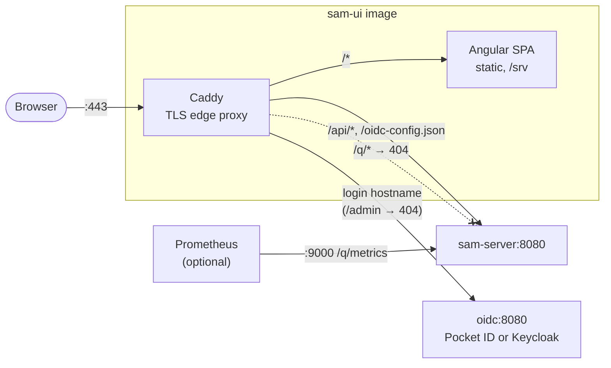
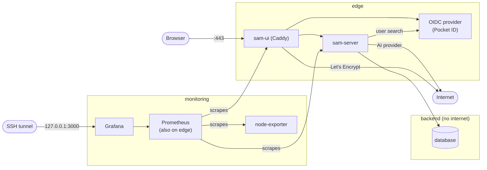

# Deployment

## Container Images

SAM ships as two Docker images:

| Image | Built by | Contents |
|-------|----------|----------|
| `ghcr.io/fhm84/sam` | Jib (`./mvnw package -Dquarkus.container-image.build=true -pl server -am`) | Quarkus server JAR — REST API, Flyway, Hibernate, LangChain4j |
| `ghcr.io/fhm84/sam-ui` | `docker build .` (multi-stage Dockerfile) | Built Angular SPA served by Caddy, which is also the TLS edge proxy |

CI publishes both images publicly to the GitHub Container Registry, for `linux/amd64` and
`linux/arm64` ([ADR-0012](decisions/adr-0012-public-images-on-ghcr.md)): every push to
`main` that passes the tests gets `latest` and `sha-<short>`, and a `v*` tag gets the version
(e.g. `1.2.0`) and `sha-<short>`. Local builds use the same names, so
`docker-compose.prod.yml` runs either; it takes the tag from `SAM_IMAGE_TAG` (default `latest`).

Caddy is the single public entry point and lives in the `sam-ui` image (`Dockerfile`, `docker/Caddyfile`, [ADR-0010](decisions/adr-0010-caddy-edge-proxy.md)). It terminates TLS (automatic Let's Encrypt certificates), serves the SPA, proxies `/api/*` and `/oidc-config.json` to `sam-server`, and proxies the login hostname to the active OIDC provider (Pocket ID or Keycloak, both reachable as `oidc:8080`; `/admin` answers 404) — the only published service (ports 80/443). All Angular API calls use relative `/api/*` paths, which Caddy forwards to the backend — no CORS configuration required.

Caddy also sets the security headers. The app gets a Content-Security-Policy (only the app's own scripts; inline styles; `data:`/`blob:` images and `blob:` frames for document previews; network calls to the app and the login host), HSTS for a year without `includeSubDomains` (other hosts of the domain may not serve HTTPS), `nosniff`, `X-Frame-Options: DENY` and `frame-ancestors 'none'`, `Referrer-Policy: same-origin` (share links carry their token in the path), a restrictive `Permissions-Policy` and `Cross-Origin-Opener-Policy: same-origin`. The login host gets HSTS and `nosniff` and keeps the provider's own CSP and referrer policy (a stricter referrer policy turns form posts' `Origin` into `null`). Caddy's `Server` header is dropped. The headers are set once the response is ready, so they replace `sam-server`'s own instead of doubling them.

Caddy writes an access log for both sites to the `caddy-logs` volume (`/var/log/caddy/access.log`, JSON, rolled at midnight, no line older than 14 days), with client IPs and with the secrets that travel in URLs (share tokens, login and sign-up links, the OIDC `code` and `state`) masked in the URI, the Referer and redirects ([ADR-0017](decisions/adr-0017-edge-access-log.md)). Reading it: [production setup](production-setup.md#6-logs-and-alerts).

`sam-server` also listens on a separate, unpublished management port (`9000`, [ADR-0007](decisions/adr-0007-management-interface.md)) for `/q/*` ops endpoints (`/q/info` for version/build-id, `/q/metrics` for Prometheus, `/q/health` for health checks) — kept off the main port so they don't fall under the public API's `@Authenticated` default. The edge proxy does not forward `/q/*` (404 from outside, [ADR-0010](decisions/adr-0010-caddy-edge-proxy.md)); Prometheus scrapes it over the internal network.

The optional `monitoring` profile (`COMPOSE_PROFILES=<provider>,monitoring`) adds Prometheus, Grafana and node-exporter: Prometheus scrapes `sam-server:9000`, Caddy's metrics site (`:9180`, not published) and the host metrics; Grafana listens on the server's loopback only and is opened through an SSH tunnel. Details: [Monitoring](../../monitoring/CLAUDE.md). Alerts don't come from these metrics: a health check on the host (every 5 minutes) and the nightly backup report to an outside dead man's switch, which notifies when a run fails or the reports stop ([ADR-0018](decisions/adr-0018-alerts-dead-mans-switch.md), [setup](production-setup.md#6-logs-and-alerts)).

`sam-server`'s compose healthcheck calls `/q/health/ready` (database reachable, storage writable), and `sam-ui` starts only once it passes, so `docker compose up -d` waits for the server and fails if it stays unhealthy ([ADR-0013](decisions/adr-0013-readiness-gates-startup.md)). `docker inspect sam-server` (`.State.Health.Log`) shows which check is down.

### Networks and container hardening

The production compose file splits the stack into networks, so a compromised edge proxy reaches little else:

| Network | Members | Notes |
|---|---|---|
| `edge` | sam-ui, sam-server, the OIDC provider, Prometheus | Has internet access (the AI provider, the provider's mail); `sam-server:9000` (health, metrics) stays reachable here |
| `backend` | sam-server, database | Internal: no internet |
| `keycloak-db` | Keycloak, its database | Internal; `keycloak` profile only |
| `monitoring` | Prometheus, Grafana, node-exporter | Grafana's loopback port is published from here |

Who talks to whom (default provider, with the `monitoring` profile):

The one-shot helpers (`sam-data-init`, the backup's `backup-files` and `restore-files`) run without a network. Every long-running service runs with `no-new-privileges`, drops all Linux capabilities except the few it needs (Caddy binds ports 80/443; Pocket ID's and Postgres' entrypoints switch from root to their own user; `sam-data-init` chowns), has a PID limit (a JVM's threads count) and rotates its logs (`json-file`, 3 × 10 MB). Root in a container therefore can't read other users' files: the backup exports Pocket ID's data as the owner of `/app/data`. Not done (yet): read-only root filesystems (`sam-server` writes large temp files when merging PDFs) and user namespaces (they change the ownership of every volume).

## OIDC Config Endpoint

`GET /oidc-config.json` is handled by `OidcConfigResource` (a `@PermitAll` JAX-RS endpoint in the `server` module). It returns `{issuerUrl, clientId, scope, roleClaimPath, roleGroups}`; issuer and client ID are sourced from `quarkus.oidc.auth-server-url` / `quarkus.oidc.client-id` — which are supplied via `OIDC_SERVER_URL` / `OIDC_CLIENT_ID` env vars. The edge proxy rewrites this path to the resource's real location (`/api/oidc-config.json`, since the JAX-RS root is `/api`), so the Angular app always gets the deployment-correct provider URL without requiring an image rebuild.

## Required Environment Variables

Copy `.env.example` → `.env` and fill in before running `docker compose -f docker-compose.prod.yml up`.

| Variable | Used by | Default | Description |
|----------|---------|---------|-------------|
| `SAM_DOMAIN`, `LOGIN_DOMAIN`, `ACME_EMAIL` | sam-ui | — | Public hostnames of the app and the login provider; Let's Encrypt contact |
| `DB_PASS` | sam-server | — | PostgreSQL password |
| `SAM_OIDC_PROVIDER` | sam-server | `pocket-id` | `pocket-id` or `keycloak` |
| `COMPOSE_PROFILES` | compose | — | `${SAM_OIDC_PROVIDER}`: starts only the active provider's containers |
| `OIDC_SERVER_URL` | sam-server | `https://<LOGIN_DOMAIN>` | Issuer URL; Keycloak: `https://<LOGIN_DOMAIN>/realms/sam` |
| `OIDC_CLIENT_ID` | sam-server | `sam-ui` | OIDC client ID |
| `POCKET_ID_ENCRYPTION_KEY` | pocket-id | — | Pocket ID only, required: encrypts its stored keys; never change it |
| `SAM_OIDC_POCKET_ID_API_KEY` | sam-server | — | Pocket ID only, optional: API key for user search when linking musicians. Full admin rights on Pocket ID — see [security](concepts/security.md) for rotation; without it, musicians are linked by user ID |
| `POCKET_ID_APP_NAME` | pocket-id | `SAM` | Pocket ID only: name on the login pages and in its mails |
| `SMTP_HOST`, `SMTP_PORT`, `SMTP_TLS`, `SMTP_FROM`, `SMTP_USER`, `SMTP_PASSWORD` | pocket-id | —, `587`, `starttls` | Pocket ID only, optional: mail server for login codes; see [Production Setup](production-setup.md#mail-and-lost-devices) |
| `POCKET_ID_EMAIL_LOGIN_CODES` | pocket-id | `false` | Pocket ID only: admins may email login codes; turn on once the test mail arrives |
| `SAM_OIDC_POCKET_ID_URL` | sam-server | `OIDC_SERVER_URL` | Pocket ID only: base URL for its API; the prod compose sets the internal `http://pocket-id:8080` |
| `KEYCLOAK_ADMIN_URL` | sam-server | `http://keycloak:8080` | Keycloak only: base URL for the admin REST client |
| `KEYCLOAK_BACKEND_CLIENT_SECRET` | sam-server, keycloak | — | Keycloak only: service account secret for user search |
| `KEYCLOAK_CLI_CLIENT_SECRET`, `KEYCLOAK_ADMIN_PASSWORD`, `KEYCLOAK_DB_PASS` | keycloak | — | Keycloak only: `cli` secret, bootstrap admin, Keycloak's database |
| `OPENAI_API_KEY` | sam-server | — | OpenAI key for document classification |
| `DB_USER` | sam-server, database | `sam` | PostgreSQL user |
| `KEYCLOAK_REALM` | sam-server | `sam` | Keycloak only: realm name |
| `KEYCLOAK_BACKEND_CLIENT_ID` | sam-server | `sam-backend` | Keycloak only: service account client ID |
| `SAM_FILESYSTEM_BASE_PATH` | sam-server | `/data/sam` | Mount point for sheet music file storage |
| `SAM_MEMBERS_RETENTION_MONTHS` | sam-server | `12` | Months after leaving until a former member's data is erased, and the age at which superseded audit rows of member profiles are deleted (nightly, 03:30); `0` turns it off ([members](../features/members.md#retention)) |
| `SAM_EVENT_LOG_RETENTION_MONTHS` | sam-server | `12` | Months after which event-log entries are deleted (nightly, 03:15; `SAM_EVENT_LOG_RETENTION_CRON` changes the time); `0` turns it off, a negative value stops startup ([event log](../features/event-log.md#retention)) |
| `GRAFANA_ADMIN_PASSWORD` | grafana | — | `monitoring` profile only, required there: Grafana's admin password (first start only) |
| `SAM_IMAGE_TAG` | compose | `latest` | Image tag, e.g. a pinned `sha-<short>` or a version |

## Storage Volume

Sheet music files are stored in a named Docker volume (`sam-data`) mounted at `/data/sam` inside the container. The path is configurable via `SAM_FILESYSTEM_BASE_PATH`. The server runs as uid 185, but a new volume belongs to root: the one-shot `sam-data-init` service hands the volume's root to uid 185 on every `up`, before the server starts. The production compose file runs Pocket ID (data in the `pocket-id-data` volume) or, with the `keycloak` profile, Keycloak with its own Postgres, which imports `keycloak/prod/sam-realm.json` on first boot — a realm without dev users or dev secrets. See [Production Setup](production-setup.md).

## Related

- [Production Setup](production-setup.md) — server, DNS, backups and go-live checklist
- [Security](concepts/security.md) — OIDC providers, user search, API key rotation
- [Storage & Deduplication](concepts/storage-and-deduplication.md) — local vs S3 backend selection
