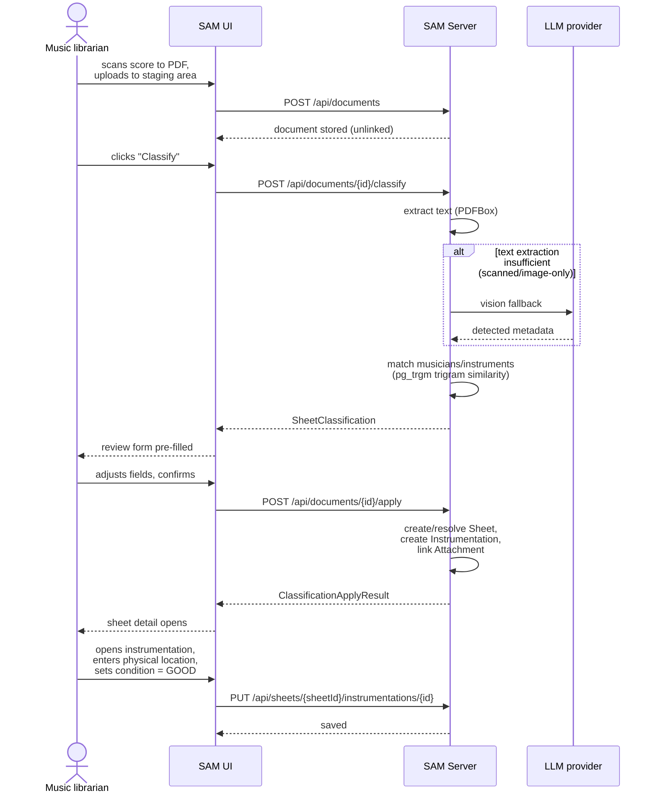
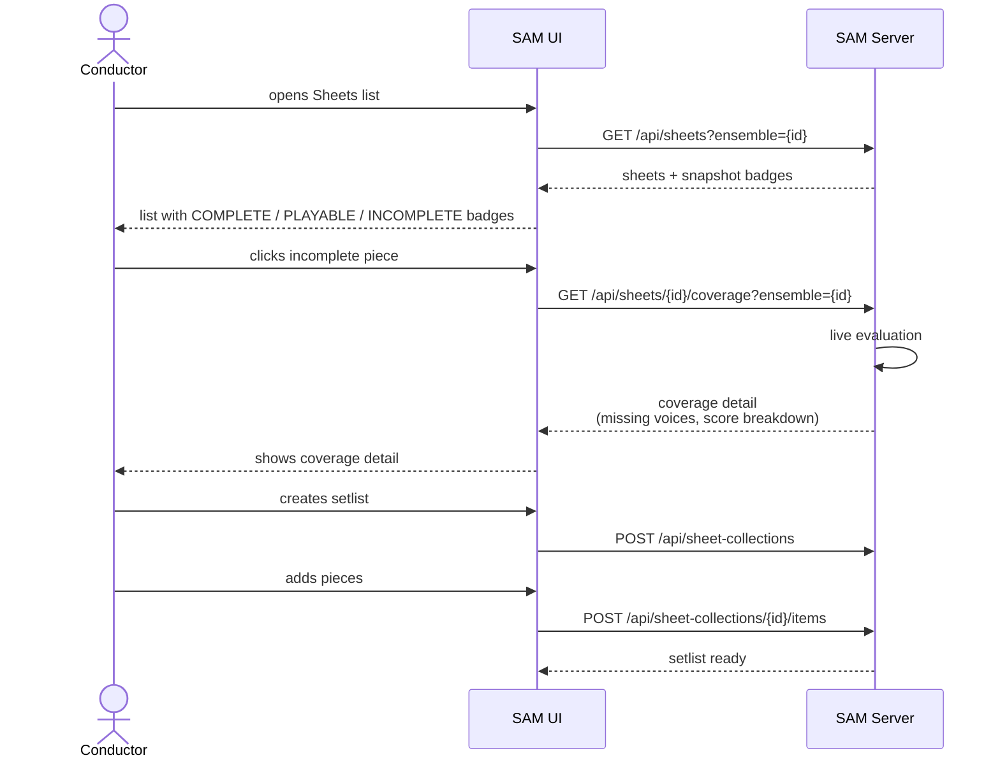
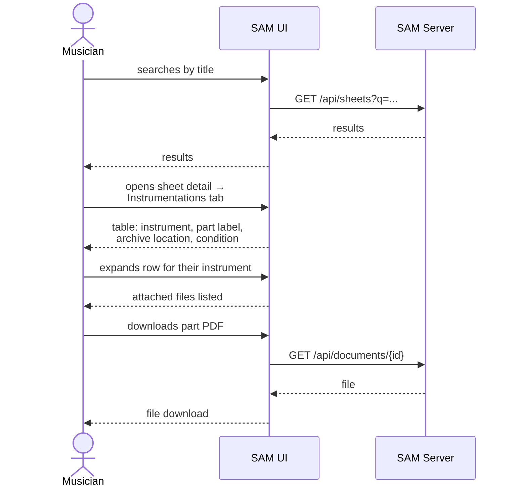
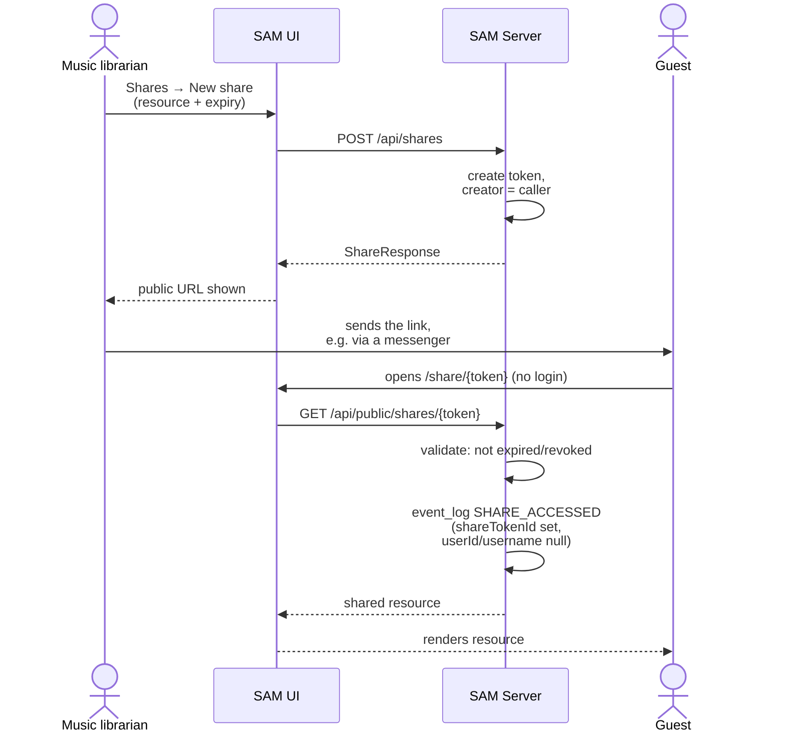

# Runtime Views

Sequence diagrams for the four core workflows. The narrative version of each flow lives
in [Stakeholders §5](../../stakeholders.md#5-key-flows). The static structure is in
[Building Blocks](../building-blocks.md#inside-the-server).

| Flow | Summary |
|------|---------|
| [1 — AI-assisted archival](#flow-1-ai-assisted-archival) | Scan → upload → classify → review → apply → record location/condition |
| [2 — Concert programme check](#flow-2-concert-programme-check) | Coverage badges → per-voice breakdown → build setlist |
| [3 — Musician retrieves part](#flow-3-musician-retrieves-part) | Search → instrumentations tab → archive location → download |
| [4 — Share creation & guest access](#flow-4-share-creation-and-guest-access) | Create token → distribute URL → unauthenticated access → event log |

## Flow 1: AI-assisted archival

A new physical score, archived by the music librarian.

## Flow 2: Concert programme check

The conductor checks what the ensemble can play and builds a setlist.

## Flow 3: Musician retrieves part

## Flow 4: Share creation and guest access

