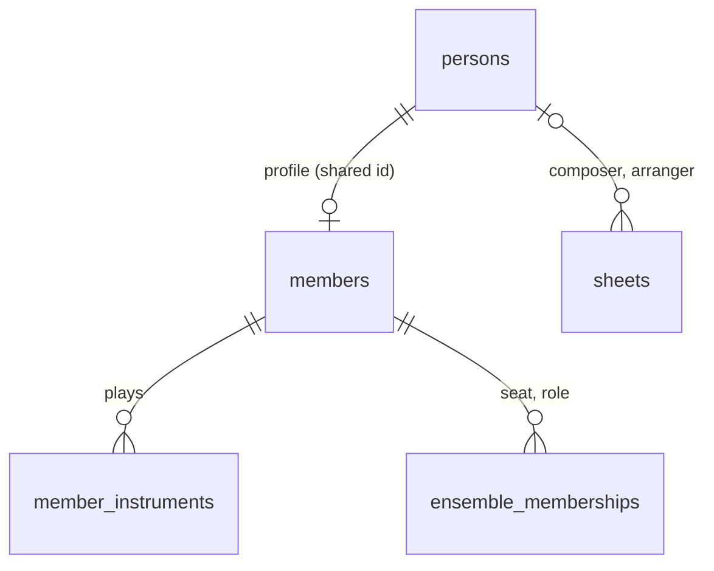

# Plan: Person Catalogue and Member Profiles

Roadmap: [Person catalogue and member profiles](../roadmap.md#person-catalogue-and-member-profiles--in-progress)
· Tracking issue: [#259](https://github.com/fhm84/sam/issues/259) (milestone [Go-live](https://github.com/fhm84/sam/milestone/1))
· Decision: [ADR-0015](../architecture/decisions/adr-0015-person-catalogue-and-member-profile.md)
· Features: [Members](../features/members.md), [People](../features/people.md), [Sheets](../features/sheets.md)
· Related: [Event log retention](event-log-retention.md) (shares the retention job)

**Why now:** before go-live nothing runs in production, so the existing migrations can
simply be changed and no data has to be migrated. Once band members log in and the roster
is maintained in production, the split would need a data migration of personal data and
its audit history, and the GDPR rules below must already apply.

## Target model

| Table | Fields | Who reads it |
|---|---|---|
| `persons` | name, name_phonetic, birthYear, deathYear, ipi | everyone who can read sheets |
| `members` | id (= person id), email, mobile, notes, membershipStatus, leftAt, lastInviteSentAt, userId | name, instruments, status: everyone; the rest: librarian and admin |
| `ensemble_memberships` | member, ensemble, voice, instrument, **role** (replaces `conductor`) | as today |

## Decisions

- **Names: `Person` and `Member`.** A person is anyone credited on a sheet (composers,
  arrangers, later lyricists, who aren't necessarily musicians). A member is a person
  who belongs to the band; an `EnsembleMembership` is one of their seats in an ensemble.
  "Musician" disappears from the model; stakeholder S3 and My Parts keep it as the
  everyday word for a member. Tables, packages, endpoints and DTOs follow:
  `persons` / `/persons` / `Person`, `members` / `/members` / `Member`,
  `member_instruments`, `ensemble_memberships.member_id`. UI labels (DE/EN):
  "Personen" / "People" and "Mitglieder" / "Members".
- **Shared primary key.** `members.id` is the person's id (an assigned `@Id` plus a
  read-only `@OneToOne @PrimaryKeyJoinColumn` to the person, `@NotAudited`; `@MapsId` was
  avoided because of its history with Envers). A member never exists without a person.
- **The existing migrations are changed, not followed by a new one.** Nothing is live, so
  `V1.0.0` / `V1.0.1` / `V1.0.6` create `persons` instead of `musicians`, `V1.0.5`
  creates `members` and the seats with a role, `V1.1.2` adds the member fields. Existing
  databases (dev, test installations) are recreated and their data re-imported with the
  `cli`; dev repairs the checksums at start (`repair-at-start`).
- **The API breaks without an alias.** The only clients are the UI and the `cli`, built
  from the same commit, and nothing is in production yet.
- **Only persons are created implicitly.** Sheet saves and AI classification resolve or
  create persons. A member profile is only created by a librarian, from scratch or from
  an existing person ("make member").
- **Credits stay two foreign keys** (`composer`, `arranger`) in this plan. More roles
  (lyricist) come later as a credits table, see
  [credit roles](../roadmap.md#credit-roles-on-sheets--idea).
- **Role per ensemble.** `MusicianRole` (`MEMBER` / `GUEST` / `SUBSTITUTE` /
  `CONDUCTOR`) moves onto `ensemble_memberships` as `EnsembleRole` and replaces the
  `conductor` flag. One member can be a regular member of the main band and a substitute
  in the youth band. A member with two voices in one ensemble has two rows; they share the
  role: setting it on one voice seat sets it on the others (`EnsembleMembershipService`),
  so a per-row edit in the UI can never get stuck on a validation error. The seat without
  a voice (the conductor's) keeps its own role, since a conductor may also play.
- **Two statuses instead of one.**
  - `MembershipStatus`, stored: `ACTIVE` · `PAUSED` (temporarily not playing, data kept)
    · `FORMER` (left the band; `leftAt` is set and starts the retention clock).
  - Onboarding state, derived and not stored: `NONE` (no login, no invite) · `INVITED`
    (`lastInviteSentAt` set, no `userId`) · `LINKED` (`userId` set). Returned in the DTO
    for the UI; nothing to keep in sync.
- **Groups are persons** (no `PERSON` / `GROUP` kind) until something needs the
  difference.
- **No type or role on the person**, see ADR-0015.

## GDPR (DSGVO)

The member profile holds the personal data; the person holds only what is printed on
the music. Retention period: **12 months**, the same as the event log
([#147](https://github.com/fhm84/sam/issues/147)), so the privacy notice explains one number.

| Situation | What happens |
|---|---|
| **Erasure request** (Art. 17) or a librarian deletes a member | Delete the member profile, its instruments and ensemble memberships, and its audit rows (`members_AUD`, `member_instruments_AUD`, `ensemble_memberships_AUD`) **immediately**. Anonymise the member's event-log entries: `userId` becomes one fixed placeholder (`erased`, the same for every erased member, not a per-person pseudonym), `username` is cleared; the entries themselves stay, so download counts stay right, and age out with the event-log retention ([event log plan](event-log-retention.md)). The person stays only if it is credited on a sheet (a credit printed on the music is not erased by leaving the band); otherwise it is deleted with its `persons_AUD` rows. The login account in Pocket ID / Keycloak is deleted there by the admin; the UI says so. |
| **Member pauses** (`PAUSED`) | Nothing is removed; login and access to their parts stay. |
| **Member leaves** (`FORMER`) | Login link removed at once (no access any more). After `sam.members.retention-months` (default 12) since `leftAt`, the nightly job deletes the profile as above. Setting the member `ACTIVE` again before that stops the clock. |
| **Audit history of active members** | The nightly job deletes `members_AUD` rows that have been superseded (`REVEND` set) for longer than the same retention period. Current values and the history of the last 12 months stay, old email addresses and phone numbers do not. |
| **Right of access** (Art. 15) | `GET /api/me/member`: the caller's own profile, memberships and instruments, shown on a "My data" page next to "My activity" from the event log plan. |
| **Data minimisation** | `notes` is for organisational notes only. Health data (allergies) is special-category data (Art. 9) and needs explicit consent; the form says "no health data" and the roadmap example goes. |
| **Information** (Art. 13) | The privacy-notice template from the event log plan (task 6) also covers member data, its purpose and the retention period. |

Why purge the audit history instead of not auditing contact fields: the history of
role, status and seat changes stays useful for a while (who played what, when), and one
retention job covers the event log, deleted members and old audit rows alike. Envers
offers no deletion of its own, so the job deletes `_AUD` rows with plain SQL.

## Tasks

| # | Task | Status |
|---|------|--------|
| 1 | Flyway: change the existing migrations in place (nothing is live): `persons` instead of `musicians` (`V1.0.0`, `V1.0.1` triggers, `V1.0.6` search), `members` (+ `_AUD`) with the shared key and `ensemble_memberships.member_id` + `role` instead of `conductor` (`V1.0.5`), the member fields and `member_instruments` (`V1.1.2`). Existing databases are recreated. `FlywaySchemaValidationTest` must pass. | [#260](https://github.com/fhm84/sam/issues/260) |
| 2 | Entities and repositories: `PersonEntity` (`business/persons/`), `MemberEntity` (`business/members/`, `@MapsId`), `SheetMusicEntity.composer/arranger` → `PersonEntity`, `EnsembleMembershipEntity.member` + `role`. Name search (`searchByName`, `findMusicianByName`, finding #6 of the 2026-10 review) moves to `PersonRepository`. | [#261](https://github.com/fhm84/sam/issues/261) |
| 3 | API: `Person` + `PersonsResource` (`/persons`: search, load, create, update, delete); `Member` (person name written through, contact, `membershipStatus`, `leftAt`, derived onboarding state, instruments, `userId`) + `MembersResource` (`/members`, link/unlink login); `SheetMusic` / `CreateSheetMusic` reference `Person`; `EnsembleMembership` gets `role`. Regenerate the TS types (`/sync-datamodels`). | [#262](https://github.com/fhm84/sam/issues/262) |
| 4 | Services: sheets and classification resolve persons; `MemberService.add` takes an existing person or creates one (closes the dedupe FIXME); delete per the GDPR table; `PersonalDataAccess` only in the member mapper; GEMA setlist and fingerprints read the person; same-role validation for a member's rows in one ensemble. | [#263](https://github.com/fhm84/sam/issues/263) |
| 5 | Access: `/persons` reads for every authenticated user, writes for librarian and admin; `/members` as `/musicians` today; tests that sheets and the sheet export carry nothing personal (`PersonalDataVisibilityTest`, `SecurityEnforcementTest`). | [#264](https://github.com/fhm84/sam/issues/264) |
| 6 | Retention: nightly job (on the scheduler from event log task 1) deletes `FORMER` members past the retention period and superseded `members_AUD` rows; config `sam.members.retention-months`; `GET /api/me/member`. Tests with backdated rows. | [#265](https://github.com/fhm84/sam/issues/265) |
| 7 | `cli` and `migration`: `exportPerson` / `importPerson`, `exportMember` / `importMember` (member JSON references its person by name, memberships carry the role); the legacy migration writes composers/arrangers as persons, the roster as members. Idempotent as before. | [#266](https://github.com/fhm84/sam/issues/266) |
| 8 | UI: "People" page (search, edit name/years/IPI, the sheets credited to a person); "Members" page (profiles only, status filter, "make member" from a person, duplicate check when creating one: "Is this the person who arranged …?"); sheet form and classification dialog pick persons with a server-side typeahead (replaces [server-side musician search](../roadmap.md#server-side-musician-search-composerarranger-fields--idea)); role per seat in ensemble memberships; "My data" page; "no health data" hint on notes. Browser-verified. | [#267](https://github.com/fhm84/sam/issues/267) |
| 9 | Merge persons: librarian-only "merge into" on the People page (repoint sheet credits and a member profile, if only one of the two has one; delete the duplicate). Can be its own pull request. | [#268](https://github.com/fhm84/sam/issues/268) |
| 10 | Docs: `data-model.md`, `features/musicians.md` → members + people, `features/ensembles-coverage.md` (role per seat), `features/api-surface.md`, `stakeholders.md` Section 6, `concepts/security.md`, `deployment.md` (retention config), `cli/README.md`, `migration/README.md`; amend ADR-0001's wording (`userId` is on the member). | [#269](https://github.com/fhm84/sam/issues/269) |

Tasks 1–5 go into one pull request (schema, entities and API must change together);
6–9 can follow separately, 10 goes with whichever task changes the page.

The pull request for tasks 1–5 also had to keep the `cli` and the UI working on the new
API, so it already brought: the `cli` person and member commands (task 7, without the
`migration` module), and in the UI a Members page (status, no role), a basic People page
(name, years, IPI), persons in the sheet form and classification dialog, a role select per
ensemble seat and the "no health data" hint (parts of task 8), plus most of the docs
(task 10, without `deployment.md`). The audit purge on member deletion (GDPR table, first
row) is in it too; the event-log anonymisation stays with task 6.

## Open questions

None left; decided on 2026-10-25: 12 months retention, anonymised event-log entries,
`PAUSED` members keep their access.

## Follow-ups from the code review

Found while reviewing tasks 1–5, not fixed there:

- **Audit purge can fail silently.** `MemberAuditPurge` runs after commit; a failure is only
  logged. Make it state-based (delete `_aud` rows whose id has no `members` row) and run it
  from the nightly retention job too (task 6).
- **`cli` file names.** `exportPerson` and `exportMember` write the same file names (a
  member and its person share name and id), and `importMember` accepts person files.
  Prefix the file names and reject files without a member-only field (task 7).
- **`importMember` with two persons of the same name** attaches to whichever the search
  returns first; resolve by exact name, oldest first, or carry the source id (task 7).
- **Lazy person on the member.** `MemberEntity.person` is eager without a fetch join, so
  member lists load each person separately; make it lazy and fetch-join where needed.
- **Duplicated logic.** "Find or create person by name" exists in `SheetService` and
  `DocumentClassificationService` (and behaves differently for stale ids), "instrument ids
  of a member" in `MyPartsService` and `SheetCollectionService`; move each into one place.
- **409 messages in the UI.** A refused delete (credited person) only shows "Request
  failed"; show the server's message.
- **Smaller items:** the seat endpoints ignore `{ensembleId}` on update and delete; the
  `MEMBER` default is set in several places; `INVITED` can't occur until the invite flow
  writes `lastInviteSentAt`.

## Later

- [Credit roles on sheets](../roadmap.md#credit-roles-on-sheets--idea): `sheet_credits
  (sheet, person, role)` with `COMPOSER` / `ARRANGER` / `LYRICIST`.
- [Automatic rights hints](../roadmap.md#automatic-rights-hints--idea): the death year
  now lives on the person.

## Key files

- `server/src/main/java/de/halbmann/sam/business/musicians/` (entity, repository, mapper, service)
- `server/src/main/java/de/halbmann/sam/business/ensembles/` (`EnsembleMembershipEntity`, `EnsembleMembershipService`)
- `server/src/main/java/de/halbmann/sam/business/sheets/` (`SheetMusicEntity`, `SheetService`, `FingerprintFactory`)
- `server/src/main/java/de/halbmann/sam/classification/controller/DocumentClassificationService.java`
- `server/src/main/java/de/halbmann/sam/business/collections/controller/GemaSetlistService.java`
- `server/src/main/java/de/halbmann/sam/business/myparts/MyPartsService.java`
- `server/src/main/java/de/halbmann/sam/security/PersonalDataAccess.java`
- `server/src/main/resources/db/migration/` (`V1.0.0`, `V1.0.1`, `V1.0.5__EnsembleMemberships.sql`, `V1.0.6__PersonSearch.sql`, `V1.1.2__MemberFields.sql`)
- `api/src/main/java/de/halbmann/sam/api/entity/musicians/`, `api/.../entity/ensembles/`, `api/.../boundary/MusiciansResource.java`
- `cli/src/main/java/de/halbmann/sam/cli/` (`MusicianImporter`, `ExportMusiciansCommand`, `ImportMusicianCommand`)
- `ui/src/main/webui/src/app/features/musicians/`, `features/sheets/sheet-form.ts`,
  `features/uploads/classification-dialog/`, `features/ensembles/ensemble-memberships.*`
